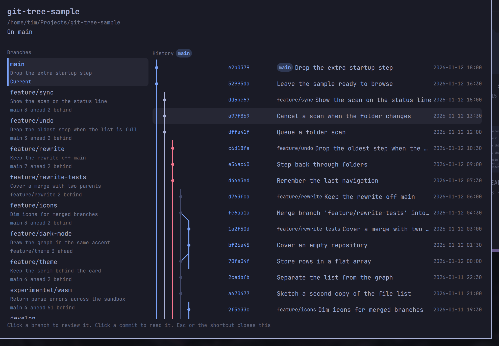
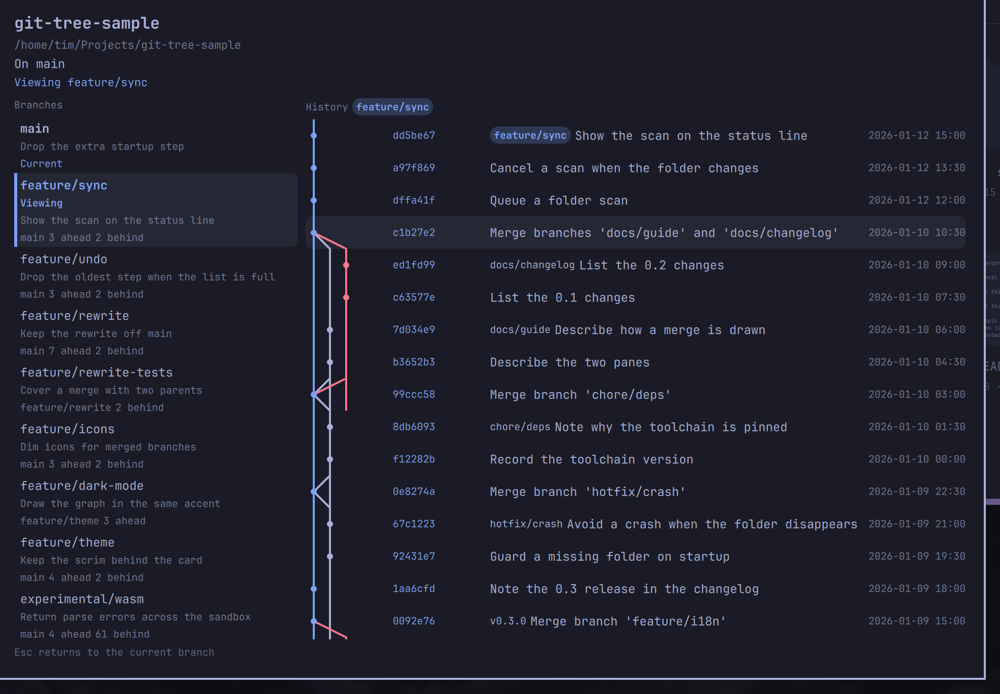
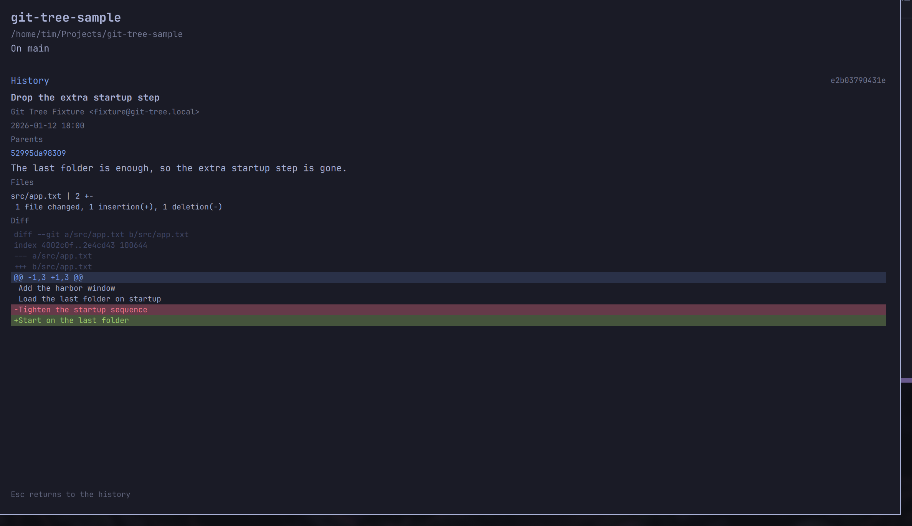

# Git Tree

Branches and recent commits for the git repository open in Files.

## What the plugin does

Enabling the plugin installs the overlay. It does not change your Hyprland keys.

Focus a Files window that is showing a git repository, then press Super+Ctrl+G. The overlay lists local branches and the recent commit graph. Click a branch to review that branch's commits. The row says Viewing. Hover a line in the graph to see which branch it is, including a remote line and a branch named by a merge. Click a local branch's line to select it in the list. The checkout stays where it is. Click the branch again to return to the whole repository. Click a commit to read its message and the diff. Commit subjects, messages, and diffs are plain text. Esc returns from a commit to the history. Esc from a branch returns to the current branch, and Esc again closes the overlay. A click on the dimmed area, or Super+Ctrl+G, closes it immediately.







Files keeps its working directory on the active pane. The overlay reads that directory from the focused Files window. The window title has to match the folder:

- The title is the folder's name, or
- The title is Home (in the language Files is using) and the directory is your home folder, or
- The title is Computer (in that same language) and the directory is `/`.

Recents, Trash, a plugin view, and a remote mount do not match, so the overlay says so and does not treat an older folder as the one on screen.

The graph includes every ref, up to 100 commits. The list on the left is local branches, up to 80.

## What you set up

The install command does not add keys. Copy `bindings.snippet.lua` into `~/.config/hypr/bindings.lua` only if you want the shortcut. If Escape is already bound, do not bind it a second time. Add the Git Tree check to that dismiss function instead. The snippet says how.

```sh
hyprctl reload
omarchy restart shell
```

`hyprctl reload` picks up the key. `omarchy restart shell` mounts the overlay. The overlay stays loaded, so a change to its QML needs another `omarchy restart shell` before the next open shows it. Saving the file alone can leave the previous overlay on screen.

Until the snippet is installed, Super+Ctrl+G does nothing for Git Tree. Super+G stays the window grouping chord.

## Requirements

- Omarchy with shell plugins
- Files (Folio)
- Hyprland Lua config (`hl.get_active_window`, `hl.get_layers`)
- `git`
- `jq`
- `hyprctl`

Quickshell ships with Omarchy.

## Install

```sh
omarchy plugin add https://github.com/timsonner/git-tree --enable
```

The command asks before it clones. Plugins run unsandboxed inside the shell. That clones the plugin to `~/.config/omarchy/plugins/timsonner.git-tree/`. Plugin id: `timsonner.git-tree`. It does not change your Hyprland keys.

If an AI agent is doing the install for you, point it at `AGENTS.md`. The agent must not copy keys unless you agree.

## Keys

| Key | Files focused, overlay closed | Overlay open |
|---|---|---|
| Super+Ctrl+G | Opens the history for the folder Files is showing | Closes the overlay |
| Escape | Passes through, unless another bind consumes it | Returns to the history when a commit is open. From a branch, returns to the current branch. Otherwise closes the overlay. The compositor bind runs before an input method |
| Click a branch | | Reviews that branch. The row says Viewing. The checkout does not change. Click the same branch again to return to the whole repository |
| Hover a graph line | | Shows that line's branch name, including a remote line or a branch named by a merge |
| Click a graph line | | Selects that local branch in the list and reviews its commits |
| Click a commit | | Opens that commit: message, file summary, and diff |
| Click History | | Returns to the branch list and the graph |
| Click the dimmed area | | Closes the overlay |

## IPC

```sh
omarchy-shell shell summon timsonner.git-tree '{}'
omarchy-shell shell hide timsonner.git-tree
omarchy-shell shell toggle timsonner.git-tree '{}'
```

The plugin target is the same three calls:

```sh
omarchy-shell timsonner.git-tree open
omarchy-shell timsonner.git-tree close
omarchy-shell timsonner.git-tree toggle
omarchy-shell timsonner.git-tree back
omarchy-shell timsonner.git-tree show <commit>
omarchy-shell timsonner.git-tree review <branch>
```

`back` returns to the history when a commit is open. From a branch, it returns to the current branch. Otherwise it closes the overlay. `show` opens one commit from the repository already on screen. `review` lists that local branch. It does not check the branch out.

## Validate

```sh
./validate
```

That checks the manifest, the lane layout, and the folder rules against a temporary git repository. It does not need a running shell.

## Uninstall

In `~/.config/hypr/bindings.lua`, remove the Super+Ctrl+G toggle. If Escape was bound only for Git Tree, remove that dismiss bind. If another dismiss function calls `omarchy-shell timsonner.git-tree back`, remove that check and leave the rest of the function. Keep your other binds. Then:

```sh
omarchy plugin remove timsonner.git-tree
hyprctl reload
omarchy restart shell
```

`omarchy plugin remove` asks before it disables the plugin and deletes a git checkout. A hand-copied folder with no git repo is moved to a timestamped backup in the plugins directory. Removing the plugin does not restore keys by itself, because those lines live in your config.

## Limits

A split Files window uses the active pane. Two Files windows share one process, and Files points the working directory at the window that is active.

The overlay does not checkout a branch, commit, or change any file. Clicking a branch only changes which commits are listed. It runs `git` with hooks disabled and does not follow a `log`, `status`, `show`, or `switch` alias.

A commit's diff is the change against its first parent, including for a merge. The patch is capped, so a very large change says it was truncated. Repo diff drivers and attributes are not used.
